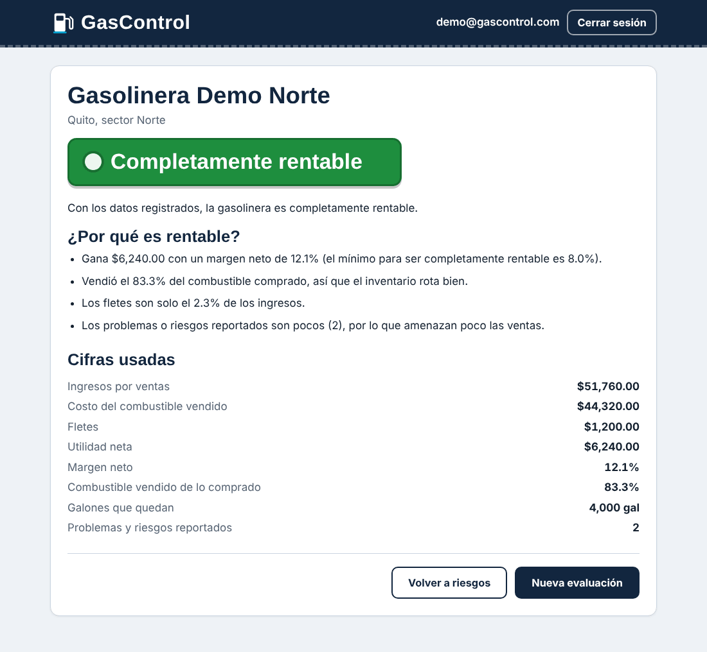
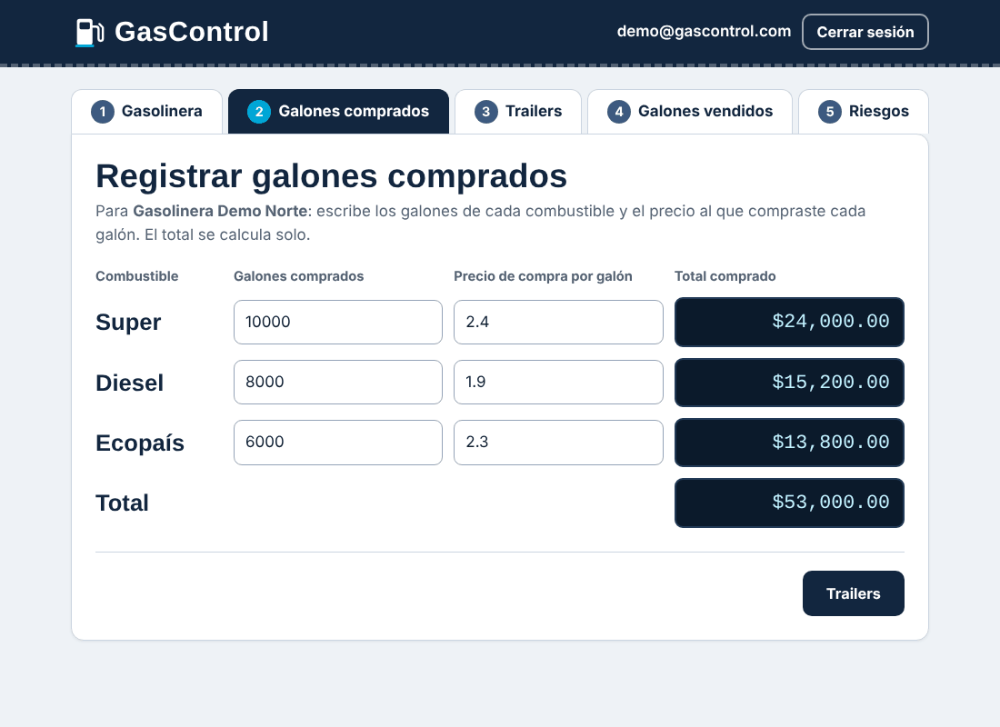
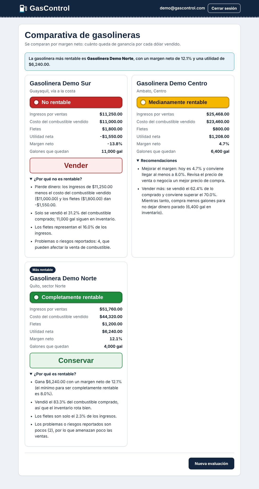
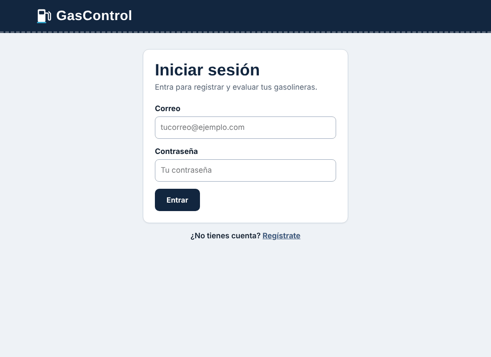
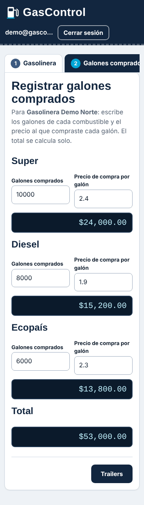

# GasControl

Aplicación web que evalúa si una gasolinera es rentable. Se registran las compras de combustible, el costo de los fletes y las ventas, y el sistema responde con un **semáforo** (rojo, amarillo o verde) que explica el porqué. Si se evalúan dos o más gasolineras, las compara y sugiere **Vender** (rojo) o **Conservar** (verde).

**Demo en línea:** _(pega aquí la URL de Render cuando termines de desplegar, ver la sección "Despliegue")_



## Capturas

| Registro de compras | Comparativa de gasolineras |
| --- | --- |
|  |  |

| Inicio de sesión | En el celular |
| --- | --- |
|  |  |

## Qué hace

1. **Gasolinera:** se registra el nombre y la ubicación.
2. **Galones comprados:** Super, Diesel y Ecopaís, con el precio por galón. El total se calcula solo.
3. **Trailers:** valor del flete de cada camión.
4. **Galones vendidos:** con el resumen de lo vendido y lo que queda en inventario.
5. **Riesgos:** se anotan los problemas y riesgos, y se elige **Agregar gasolinera** o **Calcular riesgo**.

Con una sola gasolinera se muestra el semáforo con la explicación. Con dos o más se abre la comparativa.

### Cómo se calcula el semáforo

```
Utilidad neta = ingresos por ventas - costo del combustible vendido - fletes
Margen neto   = utilidad / ingresos x 100
Rotación      = galones vendidos / galones comprados x 100
```

| Color | Condición |
| --- | --- |
| Rojo (no rentable) | No hay ventas, o la utilidad es 0 o negativa, o el margen es menor a 3 % |
| Verde (completamente rentable) | Margen de 8 % o más, rotación de 70 % o más y 3 riesgos reportados o menos |
| Amarillo (medianamente rentable) | Todo lo demás |

Los umbrales están en las constantes de `models/evaluacion.rb`.

## Tecnologías

- **Back-end:** Ruby, Sinatra y ActiveRecord (patrón MVC), base de datos SQLite, contraseñas con bcrypt.
- **Front-end:** vistas ERB, CSS escrito en **Sass (SCSS)** con nomenclatura **BEM**, maquetación con **Flexbox** y **CSS Grid**, y **media queries** para tableta y celular.
- **Servidor:** Puma. Despliegue en Render.

## Ejecutar en tu computador

Requisitos: Ruby 3.1 o superior y Git.

```powershell
git clone https://github.com/TU_USUARIO/gascontrol.git
cd gascontrol
bundle install
bundle exec rake db:migrate
bundle exec rake css:build
bundle exec ruby app.rb
```

Abre http://localhost:4567. Para crear un usuario se necesita el **código único de registro**: `252516` (se cambia con la variable `CODIGO_REGISTRO`).

### Datos de demostración

```powershell
bundle exec rake demo:cargar
```

Crea el usuario `demo@gascontrol.com` con la contraseña `demo1234` y tres gasolineras de ejemplo, una por cada color del semáforo (`db/seeds.rb`). Se puede ejecutar varias veces sin duplicar datos.

### Variables de entorno

| Variable | Para qué sirve | Valor por defecto |
| --- | --- | --- |
| `SESSION_SECRET` | Firma las cookies de sesión. En producción debe ser un valor largo y secreto. | Una clave solo para desarrollo |
| `CODIGO_REGISTRO` | Código que se pide al crear un usuario. | `252516` |
| `RACK_ENV` | Entorno (`development` o `production`). | `development` |

## Estilos con Sass y BEM

Los estilos se escriben en `scss/` y se compilan a `public/css/app.css`, que es el único CSS que carga el navegador.

```powershell
bundle exec rake css:build    # compila una vez
bundle exec rake css:watch    # recompila cada vez que guardas un .scss
```

En desarrollo también se recompila solo al recargar la página. El archivo `public/css/app.css` se incluye ya compilado, así que la aplicación se ve bien aunque no se compile de nuevo.

Qué se usa de Sass:

- **Variables y mapas:** colores, fuentes, puntos de quiebre y colores del semáforo (`scss/abstracts/_variables.scss`).
- **Mixins:** `hasta` (media query), `flex`, `cuadricula` (grid), `superficie`, `titulo`, `boton-variante`, `truncar` y `foco` (`scss/abstracts/_mixins.scss`).
- **Anidación** con `&` para elementos, modificadores y estados (`&__elemento`, `&--modificador`, `&:hover`).
- **Componentes:** un parcial por componente en `scss/components/`, reunidos con `@use` en `scss/main.scss`.
- **`@each` sobre un mapa** para generar las variantes del semáforo.

Nomenclatura **BEM** (`bloque__elemento--modificador`), por ejemplo `.pasos`, `.pasos__tab--actual`, `.semaforo--rojo` y `.tabla-combustibles__fila--cabecera`.

## Estructura del proyecto

```
gascontrol/
├── app.rb                  # configuración de Sinatra y arranque
├── config.ru               # punto de entrada para el servidor
├── Gemfile  Rakefile       # gemas y tareas (db:migrate, css:build, demo:cargar)
├── render.yaml  Procfile   # despliegue
├── config/database.yml     # base de datos por entorno
├── models/                 # Gasolinera, Compra, Venta, Flete, User, Evaluacion (semáforo)
├── controllers/            # AuthController, GasolinerasController
├── helpers/                # formato de dinero y autenticación
├── views/                  # vistas ERB
├── db/migrate/  db/seeds.rb
├── scss/                   # abstracts, base, layout y components
├── lib/css_builder.rb      # compila Sass desde Ruby
├── public/css/app.css      # CSS compilado
└── docs/img/               # capturas de este README
```

## Seguridad

- Las contraseñas se guardan con **bcrypt** (`has_secure_password`).
- Los datos se **validan en el servidor** antes de guardarse: correo y contraseña en `models/user.rb`, y los números de compras, ventas y fletes en el controlador.
- El código único de registro se compara con `Rack::Utils.secure_compare` y la sesión se reinicia al iniciar sesión.
- Cada usuario solo puede ver y modificar sus propias gasolineras.

## Despliegue en Render

El archivo `render.yaml` ya describe el servicio, así que no hay que configurar nada a mano.

1. Sube el código a GitHub (ver la sección siguiente).
2. Crea una cuenta en [render.com](https://render.com) e inicia sesión con GitHub. El plan gratuito no pide tarjeta.
3. Pulsa **New +**, luego **Blueprint**, elige este repositorio y pulsa **Apply**.
4. Espera a que termine el despliegue (unos minutos). Render muestra la URL pública, algo como `https://gascontrol.onrender.com`.
5. Pega esa URL en la línea **Demo en línea** al inicio de este archivo.

Durante el arranque se crean las tablas (`db:migrate`) y se cargan los datos de demostración (`demo:cargar`). La clave de sesión (`SESSION_SECRET`) la genera Render.

**Limitaciones del plan gratuito:**

- El servicio se duerme tras 15 minutos sin visitas. La primera visita después tarda cerca de un minuto en responder.
- El disco es temporal: la base SQLite se reinicia cuando el servicio se reinicia o se vuelve a desplegar. Por eso el arranque carga los datos de demostración. Para guardar datos de forma permanente haría falta una base de datos externa (por ejemplo PostgreSQL) o un plan con disco persistente.

## Flujo de trabajo con Git

- Rama principal: `main`.
- Commits pequeños, con un mensaje que dice qué cambió y por qué.
- El archivo `.gitignore` deja fuera la base de datos local, `Gemfile.lock` y los archivos del editor.

```powershell
git status
git add .
git commit -m "Describe el cambio"
git push
```

## Autor

Abraham Silva. Proyecto de la materia **ISWZ3101-2679: Ingeniería Web**, Universidad de Las Américas (UDLA), Ecuador.
